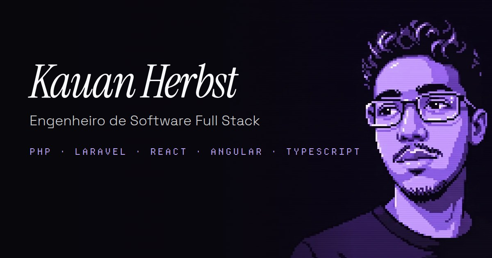

# Kauan Herbst · Portfólio

[](https://kauanherbst.dev)


Portfólio pessoal de **Kauan Herbst**, engenheiro de software full stack (PHP / Laravel, React, Angular e TypeScript). Uma landing page em português e inglês com experiência, formação, projetos, habilidades e contato, construída com o [Herbst UI](https://ui.kauanherbst.dev), minha biblioteca open source de componentes para Angular.

**[kauanherbst.dev](https://kauanherbst.dev)**



## Destaques

- **Pré-renderizado (SSG):** o HTML já sai com todo o conteúdo no build, com hidratação incremental das seções abaixo da dobra.
- **Bilíngue:** português e inglês com troca instantânea ([Transloco](https://jsverse.gitbook.io/transloco)), escolha salva no navegador e `<html lang>` e título acompanhando o idioma.
- **Acessível:** navegação por teclado, textos para leitores de tela nas animações, avisos de links externos, menu mobile em diálogo com foco gerenciado e respeito a `prefers-reduced-motion`.
- **Rápido:** seções carregadas sob demanda com `@defer`, fontes self-hosted com fallback de métricas ajustadas (sem layout shift) e animações que rodam no compositor.
- **SEO:** canonical, Open Graph, Twitter Card, dados estruturados `Person` (JSON-LD), `sitemap.xml` e `robots.txt`.
- **Identidade visual:** pixel art em uma paleta roxa de cinco cores, vídeo de abertura no hero e animações de entrada disparadas pelo scroll.
- **Currículo para download** em português e inglês direto do header.

| Lighthouse | Performance | Acessibilidade | Boas práticas | SEO |
| ---------- | :---------: | :------------: | :-----------: | :-: |
| Desktop    |     100     |      100       |      100      | 100 |
| Mobile     |     ~91     |      100       |      100      | 100 |

## Stack

| Camada    | Tecnologias                                                                 |
| --------- | --------------------------------------------------------------------------- |
| Framework | Angular 22 (standalone, zoneless, signals), `@angular/ssr` em modo estático |
| UI        | [Herbst UI](https://ui.kauanherbst.dev), Angular CDK, Embla Carousel        |
| Estilo    | Tailwind CSS 4                                                              |
| i18n      | Transloco                                                                   |
| Ícones    | ng-icons (Phosphor)                                                         |
| Testes    | Vitest                                                                      |
| Qualidade | TypeScript, Prettier                                                        |

## Rodando localmente

Pré-requisitos: Node.js 22.22+ ou 24.15+ e npm.

```bash
npm install
npm start
```

Abra `http://localhost:4200`.

| Comando         | O que faz                                                |
| --------------- | -------------------------------------------------------- |
| `npm start`     | Servidor de desenvolvimento com renderização no servidor |
| `npm run build` | Build de produção com pré-renderização em `dist/`        |
| `npm test`      | Testes unitários com Vitest                              |

O build gera um site 100% estático em `dist/portfolio-kauanherbst/browser`, pronto para qualquer hospedagem estática (Vercel, Netlify, Cloudflare Pages, GitHub Pages).

## Estrutura

```
src/
├── index.html              Metadados de SEO, Open Graph e JSON-LD
├── styles.css              Tema, fontes e utilities (eyebrow, icon-btn, reveal)
└── app/
    ├── core/               Dados que não mudam com o idioma (links, projetos, seções)
    ├── i18n/               Textos em pt.json e en.json + configuração do Transloco
    ├── layout/             Header, menu mobile, rodapé e componentes compartilhados
    ├── sections/           Seções da landing page (hero, sobre, timeline, projetos…)
    ├── motion/             Revelação no scroll, digitação e texto embaralhado
    ├── art/                Pixel art desenhada pixel a pixel em canvas
    └── shared/ui/          Componentes do Herbst UI (copiados via CLI)
public/
├── art/                    Pixel arts das tecnologias e dos projetos
├── hero/                   Vídeo e imagens do hero (desktop e mobile)
├── cv/                     Currículos em PDF
└── fonts/                  Fontes self-hosted e licenças
```

## Editando o conteúdo

- **Textos** (cargo, bio, experiência, formação, projetos, skills, contato): `src/app/i18n/pt.json` e `src/app/i18n/en.json`. O tipo dos textos é inferido do `pt.json`, então o build falha se faltar alguma chave no inglês.
- **Links, imagens, stack dos projetos e redes sociais:** `src/app/core/content.ts`.
- **Currículos:** substitua os PDFs em `public/cv/` mantendo os nomes.
- **Novos componentes do Herbst UI:** `npx herbst-ui@latest add <componente>`.

## Créditos

- Fontes: [Instrument Serif](https://github.com/Instrument/instrument-serif) e [Space Grotesk](https://github.com/floriankarsten/space-grotesk) (SIL Open Font License) e [Departure Mono](https://departuremono.com) (licença em `public/fonts`).
- Logos das tecnologias redesenhados em pixel art a partir do [Simple Icons](https://simpleicons.org) (CC0).

## Contato

- E-mail: [kauanherbst7@gmail.com](mailto:kauanherbst7@gmail.com)
- LinkedIn: [in/kauanherbst](https://www.linkedin.com/in/kauanherbst)
- GitHub: [@KauanHerbst](https://github.com/KauanHerbst)
